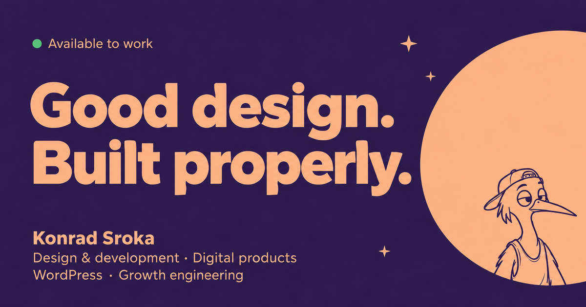

# konradbuilds.github.io

My portfolio site. One standalone HTML file, with editable source and regression tests for development.

<a href="https://konradbuilds.github.io/" target="_blank" rel="noopener noreferrer"></a>

**Live:** <a href="https://konradbuilds.github.io/" target="_blank" rel="noopener noreferrer">Open the portfolio →</a>

## What's in here

| Path              | What                                              |
| ----------------- | ------------------------------------------------- |
| `index.html`      | The whole site — markup, CSS and JS in one file    |
| `assets/img/`     | Project screenshots (WebP + JPEG fallbacks) and the avatar          |
| `CNAME.example`   | Rename to `CNAME` to serve it on your own domain   |

## How it's built

- Plain HTML, CSS and vanilla JavaScript. No framework or runtime build dependency.
- Ordered source modules build into a single HTML file.
- Illustrations are inline SVG, so they cost no extra request.
- Live Bangkok time and weather come from <a href="https://open-meteo.com/" target="_blank" rel="noopener noreferrer">Open-Meteo</a> at runtime; the page works without them.
- The contact form posts to Formspree. JavaScript adds an in-page status; without it, native POST still works.

## Run it

Open `index.html` in a browser. That's it.

## Edit, build and test

Requires Node 20 or newer for development.

```sh
npm install
npm run build
npx playwright install --with-deps
npm test
npm run test:contact
npm run test:mobile
```

Edit `src/index.html`, `src/styles.css` and the ordered modules in `src/js/`. The build needs no dependencies or network connection; Playwright is only used for tests. See `docs/architecture.md` and `docs/verification.md` for tradeoffs, checks and browser limits.

## What to upload

Upload **dist/index.html** as the root **index.html**. Keep existing assets and PDFs. All CSS and JavaScript are inside the generated HTML. AI tools are named in plain text. Source files and tests can also be committed for reviewers, but are not required to run the page. The root index.html is the generated production build.

## Deploy

GitHub Pages, from the `main` branch, root folder. Settings → Pages.

## License

Code: MIT. Images, copy and the CV content: © Konrad Sroka, all rights reserved.


Returning visits show client-project/CV shortcuts at the intro edges. First visits show only the scroll prompt. The browser stores one local visit flag; unavailable storage keeps the shortcuts hidden.

The ZIP includes assets/img/og-whatsapp-v3.jpg (157 KB). Keep this share image when uploading the generated HTML; it is already deployed live. Returning shortcuts nudge inward then slide outward over the first 210px of scrolling, using the shared scheduler.

## Image compatibility

Each photo uses a native picture element: WebP first, JPEG fallback. Dimensions, alt text and loading priorities live on the img element. No JavaScript detection.

Run `npm run test:images` to verify decoding, source selection and responsive layout in Chromium, Firefox and WebKit. JPEG selection is tested by making the WebP source type unsupported; this exercises the fallback but does not emulate native Safari 13.

### v3.3.16

- Original bird head rises from behind the email field, half-size, with more body inside an 80px clipping window.
- Form gap reduced by 50px; staggered wink and slow retreat on confirmed send.
- Brief eye-roll into eye contact, then eased mouse tracking on desktop.
- Ink bird above the email field; snappy entrance and confirmed-submit wink.
- Visible sidebar keeps its original sonar timing; the bolt has a subtle CSS pulse.
- Tracking detaches when parked, offscreen or hidden; no idle animation loop.
- Mobile return links clear browser controls; top bird fully retracts.
- Zoom measurements use the stage height, so collapsing browser controls cannot
  change the scroll progress. Width and orientation changes still remeasure.
- Project tags describe the actual work; PCO support has its own paragraph.

Published build: v3.3.16.
